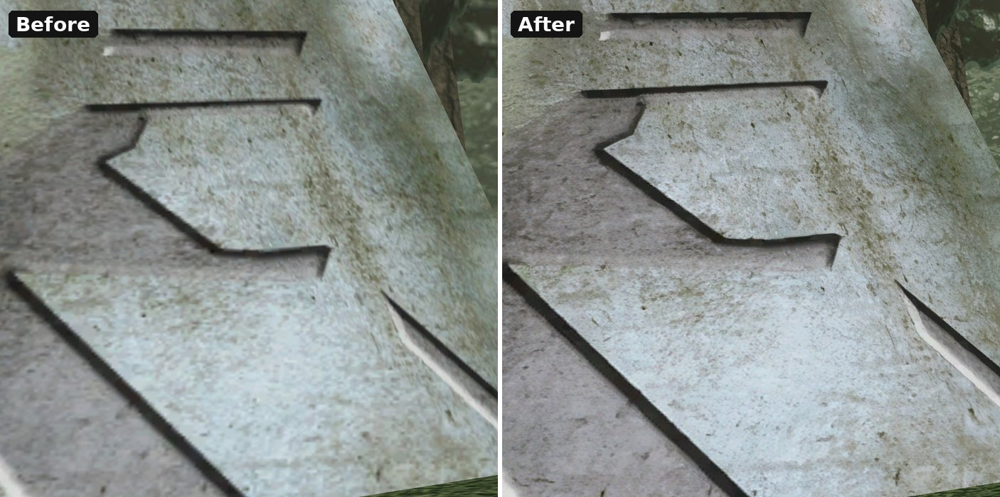
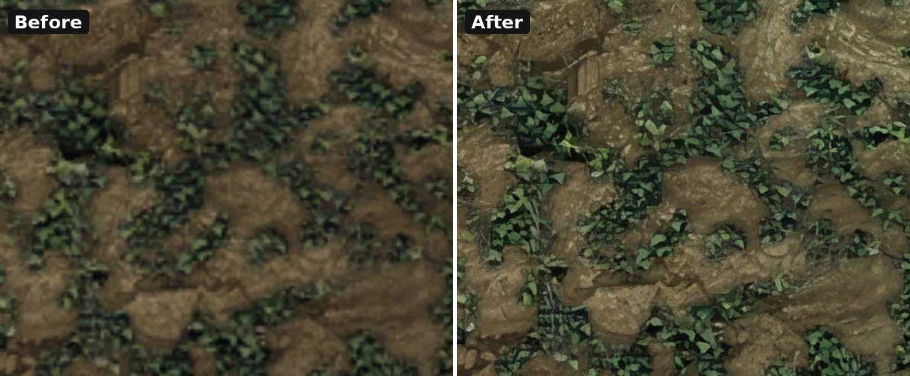
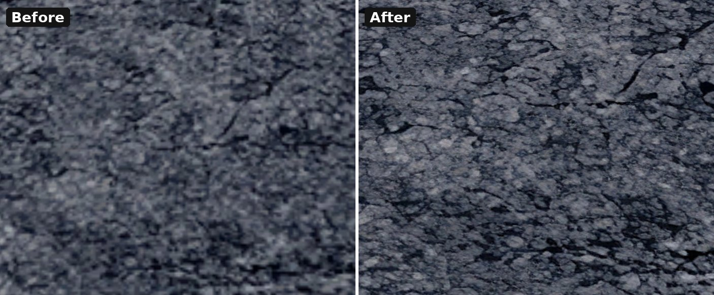

# eq-hd-textures

Upscales the textures in EverQuest's `.s3d` archives 4× with a local
super-resolution model, and installs the sharper versions into your game. It
covers zones, zone objects, characters and equipment.

Currently only covers textures that are the original small resolution, this
is somewhere around Gates of Discord, with a few additional archives from
Omens of War and Dragons of Norrath. Expansions after this are already high
quality and therefore are skipped. 

Most people should use **the Windows app** below: download, extract, click
Render, then Install. A [command line](#command-line) is there too, for Linux
and WSL or if you prefer a terminal.

> Using these textures on Live likely breaks the EULA/TOS. Use at your own risk.

> **Do not share the upscaled textures.** They're made from EverQuest's
> game files, which are copyrighted by Daybreak Game Company. Uploading,
> sharing or selling them, or any pack, mod or archive that contains them,
> would infringe Daybreak's copyright and may also break EverQuest's terms of
> service. That's why everyone renders their own, on their own PC, from their
> own copy of the game. Share the tool instead.

## Performance penalty
There is a performance penalty by using these textures. Loading takes a few
seconds longer, each instance of EQ will use more VRAM, and there's a bit
of an FPS drop when you first enter a zone while the textures get drawn 
for the first time. In my experience, this FPS drop only lasts a few seconds, 
and it helps to "look around" to hurry it up it.

## Before and after







*In-game screenshots from the live client, before and after Install. EverQuest
and its art © Daybreak Game Company.*

## What you need

- An NVIDIA graphics card (CUDA) with an up-to-date driver. A full install is
  about 67,000 textures, roughly 20 hours on an RTX 3090; you can pause, stop
  and continue whenever you like.
- About 40 GB of free disk space for a full install (see the next section).

## Disk space: two copies of every upscaled texture

**This tool deliberately keeps two copies of the upscaled textures:**

| Where | What | Size (full install) |
|---|---|---|
| The data folder (`%LOCALAPPDATA%\eq-hd`, or `output/` for the command line) | every upscaled archive, kept | about 18 GB |
| The EverQuest folder, after Install | the same archives, replacing 1.7 GB of originals | about +16 GB |
| The data folder | the upscaling engine (PyTorch) | about 7 GB |

**Why:** the EverQuest launcher puts the original textures back every time it
runs, on patch day or whenever it checks the files. With the upscaled copies
kept in the data folder, getting them back is a few minutes of Install. Without
them, it would be hours of rendering every time. After a patch, only the
archives the patch changed are rendered again.

If you need the space back, *Settings → Delete rendered data* removes the data
folder's copy (and the engine); EverQuest keeps the installed copy until the
launcher restores the originals. Render checks there's room in the data folder
before it starts, and Install checks there's room in the EverQuest folder.

## The Windows app

**Download:** get `eq-hd-textures-<version>-windows.zip` from the releases,
extract it (right-click → *Extract All*) anywhere, and double-click
`EQ HD Textures.exe` in the extracted folder. Nothing else needs installing
except an up-to-date NVIDIA driver. The app isn't signed: the first time,
Windows may say *Windows protected your PC*; click *More info*, then *Run
anyway*.

The first launch downloads PyTorch and the upscaling engine (about 3.7 GB, with
a progress bar; an interrupted download resumes next time). After that:

- **EverQuest folder** is found automatically when it's in a usual place;
  otherwise choose it with Browse.
- **Render** upscales whatever isn't done yet into the data folder. It never
  touches EverQuest. After a patch, or after using the launcher, only new or
  changed textures are upscaled.
- **Install** copies the rendered archives into EverQuest (it renders nothing).
  When a render finishes, the window says so: click Install. It only replaces an
  archive that's still exactly the original it was made from, and waits while
  the game is running.
- **Pause / Resume** holds the work between GPU batches; **Stop** ends the run
  (finished archives are kept; Render continues where it left off).
- **Settings**: the data folder (default `%LOCALAPPDATA%\eq-hd`; it needs about
  18 GB for the upscaled archives plus about 7 GB for the engine, so pick a big
  drive if C: is small; EverQuest's own folder also grows by about 16 GB once
  installed), and *Pause while EverQuest is running* (on by default:
  the game stays smooth, and the work continues when you quit).

**Start the game with `eqgame.exe patchme`, not the launcher.** Every time the
launcher starts it checks the game files and puts the original archives back.
After patch day (or any time you've used the launcher), click Render (only
patched textures are upscaled again), then Install.

### Uninstalling and cleaning up

The app has no installer, so it isn't listed in Windows' *Installed apps*.
To remove everything:

1. **Restore EverQuest's original textures**: start the normal EverQuest
   launcher once and let it check the files. Until then EverQuest keeps the HD
   textures, even after everything below is deleted.
2. **Delete the data** (rendered archives, engine, downloads, about 25 GB): in
   the window, *Settings → Delete rendered data…*. Or, with the window closed,
   delete the data folder yourself: `%LOCALAPPDATA%\eq-hd`, or wherever you
   moved it in Settings (*Settings → Open data folder* shows it).
3. **Delete the app**: close the window and delete the `EQ HD Textures` folder
   you extracted (or, for a source checkout, the checkout and its `.venv-gui`).
4. **Delete the settings**: delete the folder `%LOCALAPPDATA%\eq-hd` (it holds
   `settings.ini`: the EverQuest folder, the data folder and a couple of
   switches). Nothing is kept anywhere else, not in the registry either.

## Command line

For Linux and WSL, or if you'd rather use a terminal. It needs
[uv](https://docs.astral.sh/uv/), which installs Python 3.12, PyTorch (CUDA
12.8) and the other dependencies on first run. It works under WSL, where Windows
paths are accepted (`--eq-directory 'C:\EverQuest'`), as well as on Linux and
Windows.

```bash
uv run eq-hd --eq-directory /mnt/c/EverQuest
```

Results land in `output/s3d/`. Either copy them into your EverQuest directory
yourself:

```bash
cp output/s3d/*.s3d /mnt/c/EverQuest/
```

or let the tool do it with `--install`. It copies each archive as soon as it's
finished, so a long run that you stop part way is already partly installed.

Without `--install` the tool **never writes to the EverQuest directory**. With
it, it only ever replaces an `.s3d` archive with its own upscaled version, and
only if the file in EverQuest is still exactly the original it was made from.
It never copies while `eqgame.exe` is running: finished archives wait until the
game has closed.

**Start the game with `eqgame.exe patchme`, not the launcher.** Every time the
launcher starts it checks the game files and puts the original archives back.
That's also how to undo everything. After patch day (or any time you've used
the launcher), run the same `--install` command again. Archives the patch didn't
change are copied back from `output/s3d/` in minutes. Changed archives are
re-rendered, re-using every texture inside them that didn't change.

### Usage

```bash
uv run eq-hd --eq-directory PATH [options]
```

| Option | |
|---|---|
| `--dry-run` | Show what would be processed, the time estimate and disk needs, then stop |
| `--include GLOB` | Only some archives, e.g. `--include 'gequip*.s3d' --include 'nexus*.s3d'` |
| `--install` | Copy finished archives into the EverQuest directory (see above) |
| `--no-render` | With `--install`: only copy what's already rendered |
| `-y`, `--yes` | Don't ask before starting (needed when not run from a terminal) |
| `--output PATH` | Somewhere other than `output/` (never inside the EQ directory) |
| `--force` | Re-render archives that are already up to date |
| `--model PATH` | A different Spandrel-compatible model |
| `--events` | Machine-readable progress for front ends: JSON lines on stdout; reads `pause`, `resume`, `stop` on stdin |

Progress goes to the terminal and to `output/run.log`, so you can follow a long
run from another terminal with `tail -f output/run.log`. Before starting, a run
estimates its duration from the speed measured on earlier runs (a rough RTX 3090
figure the first time). During the run, the ETA uses the run's own speed. Both
work per megapixel of source texture, so a mix of small and large textures
doesn't skew them.

#### Stopping, resuming and patch days

Stop at any time with Ctrl-C and run the same command again. Archives that
finished are kept, and the one in progress starts over.

Every run fingerprints each archive (sha256) and compares it with
`output/state.json`. Only archives that are new, have changed (for example
after a patch), failed last time, or were made with different settings are
processed. A full fingerprint pass takes a few seconds.

Every output archive also carries an `EQHD` marker in its footer, a field the
client ignores. When you've copied outputs into the EverQuest directory, a later
run recognises them as its own and never upscales them twice. That works even if
`output/` has been deleted. If an installed output is out of date (you changed
settings, or a newer version of the tool would render it differently), the run
reports it as *installed, stale*. Restore the original with the launcher's file
check, then run again.

Keep `output/` if you use `--install`: after the launcher or a patch has put
originals back, re-installing copies from `output/s3d/` instead of re-rendering,
and re-rendering a patched archive takes its unchanged textures from there.
`output/state.json` records what was made from what; without it, everything
that isn't installed is processed again.

## What it does to each archive

- **Finds textures by content.** Live stores DDS data in many files still named
  `.bmp`.
- **Upscales** DXT1/DXT5 DDS and classic 8-bit palettized BMPs whose largest
  side is 17–512 px. Smaller ones are mostly solid-colour swatches; larger ones
  are already high resolution. Everything else (geometry, DXT3,
  uncompressed formats) is copied through byte for byte.
- **Prepares the edges.** Colours are bled into transparent pixels first, so the
  model doesn't pull dark halos into visible edges. Zone textures are
  wrap-padded so tiling surfaces stay seamless, and character and equipment
  skins are mirror-padded.
- **Keeps each texture's format.**
  - DDS keeps its original header and format. Textures that had a mip chain
    get a full new one.
  - On/off transparency gets smooth outlines rather than enlarged pixel steps,
    without losing 1–2 px features like wires or grass. Graded alpha (DXT5
    masks) is resized smoothly.
  - 8-bit BMPs stay 8-bit BMPs with the same palette. The upscaled colours are
    mapped back onto palette entries 1–255, and index 0 (EQ's transparent key
    colour on masked materials) is put back exactly where the original had it.
    Transparency then behaves as before, without needing the zone's material
    data.
- **Re-uses textures it has already upscaled.** A texture whose original bytes
  match one in an earlier output (same settings) is copied from there, so a
  patched archive only sends its new or changed textures through the model.
- **Leaves out 124 archives the EverQuest launcher doesn't track**
  (`src/eq_hd/untracked.py`): mostly old zone-specific creature archives, and
  the pre-revamp Commonlands and Highpass. Not even a full verify restores
  them, so an upscaled copy would stay in EverQuest for good. The game doesn't
  appear to use them.
- **Skips archives that are damaged as shipped** (the live install has one,
  `eye_chr.s3d`, whose file table lists a file it doesn't contain), leaving them
  as they are.
- **Repacks the archive faithfully**: same file order, filename-table marker,
  name case and stored checksums, including the few shipped entries whose
  checksum doesn't match their name.

## Model

The default is [4x-PBRify_UpscalerV4](https://openmodeldb.info/models/4x-PBRify-UpscalerV4)
(DAT2 architecture, CC0-1.0). It's downloaded into `models/` on first use and
checked against a pinned sha256. Models are loaded with PyTorch's
`weights_only=True`, so a `.pth` file can't run code.

## Development

```bash
make test        # or: uv run pytest
make gui         # the window, using this checkout's .venv as its engine
make windows     # the Windows download: dist/eq-hd-textures-<version>-windows.zip
make clean       # remove downloaded and temporary files (never output/)
```

To try a change in the window on Windows, build the zip (`make windows`),
extract it, and run `EQ HD Textures.exe`. Extract each new build to the same
folder, so the engine isn't set up again every time.

`make windows` runs on Linux (`tools/build_windows.py`): a pinned standalone
CPython 3.12 for Windows with the `gui` group installed into it from `uv.lock`,
a pinned `uv.exe`, the app source, and the launcher `EQ HD Textures.exe`
(`tools/launcher/`, a few lines of C cross-compiled with Zig from the `ziglang`
package in the dev group). It refuses to build a zip with non-Windows files,
without the Microsoft C++ runtime DLLs, or with paths too long for Windows to
extract. GitHub Actions (`.github/workflows/windows-zip.yml`) builds it on a
`vX.Y.Z` tag matching `pyproject.toml` and checks it on Windows. Then it waits
for approval twice: once to publish a GitHub pre-release with the zip, and
again to make that the latest release. The waits need two environments,
`prerelease` and `release`, each with you as a required reviewer
(*Settings → Environments* on GitHub); without them the jobs run straight
through. Running the workflow by hand (*Run workflow*) only builds and checks.

`make clean` deletes `.venv` and `.venv-gui` (uv recreates them on the next
`uv run`, from its cache), the downloaded model in `models/` (the next render
downloads it again), `build/`, `dist/`, `work/` and Python caches. Rendered
archives and their state in `output/` are never touched.

`uv run eq-hd` uses the default dependency groups (`engine`, `dev`). The window
runs in its own small environment (`--no-default-groups --group gui`: Qt only)
and starts the engine as a separate process with `--events`.

The tests build synthetic archives and use a stand-in upscaler, so they need
neither an EverQuest install nor a GPU. One test runs the launcher on the real Windows
from WSL; it's skipped unless you ask for it with `EQHD_WINDOWS_TESTS=1 make test`.

```
src/eq_hd/
  cli.py        command line, safety checks, run loop, progress
  paths.py      EQ / output directory resolution and checks (incl. Windows paths)
  state.py      fingerprints and the up-to-date rules
  pipeline.py   per-archive selection and the CPU/GPU pipeline
  textures.py   DDS / BMP parsing, alpha handling, re-encoding
  upscaler.py   batched model inference (Spandrel + PyTorch)
  pfs.py        PFS archive reader / writer
  models.py     default model download and verification
  report.py     terminal output and --events JSON lines
  control.py    pause / resume / stop over stdin
  reuse.py      finding already upscaled textures in earlier outputs
  install.py    --install: copying into the EQ folder, game detection
  gui/          the window: engine process, engine setup, settings
```

Bump `PIPELINE_VERSION` in `src/eq_hd/__init__.py` whenever a change alters
output bytes, so existing outputs get re-rendered.

## Legal

The tool is free software under the **GNU General Public License v2**
([LICENSE](LICENSE)). The Windows download also bundles Python (PSF License),
Qt for Python / PySide6 (LGPL v3) and uv (MIT / Apache 2.0); their licences are
inside its `runtime` folder. The upscaling model, 4x-PBRify_UpscalerV4, is CC0.

The upscaled textures are derived works of Daybreak Game Company's copyrighted
game files. This repo distributes only the tool, which contains none of
EverQuest's assets. The textures it makes are for your own use with your own
copy of EverQuest: **don't redistribute them**, in any form (archives, texture
packs, mods, or the tool's output folder).

This project isn't affiliated with or endorsed by Daybreak Game Company.
EverQuest is a registered trademark of Daybreak Game Company LLC.
